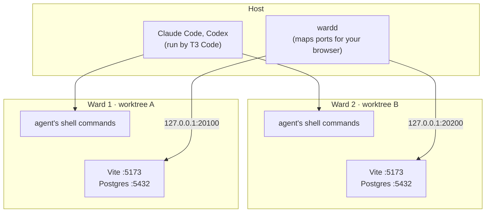

# Ward

Run several AI coding agents on one Linux machine without them colliding.

Agent tools like [T3 Code](https://github.com/pingdotgg/t3code) give each agent thread its own git worktree, so their files stay apart. Everything else is still shared: two agents both start Vite on port 5173, both run Postgres on 5432 through `docker compose`, both write caches to `/tmp`, and both install their app onto the same Android emulator. An agent that opens a browser to check its work opens it on your screen.

Ward gives each worktree a sandbox, called a ward, with its own:

- **network**: a private `localhost`, so every agent can use 5173 and 5432 at once
- **containers**: a private Podman, behind the usual `docker` and `docker compose` commands
- **temp folder**: a private `TMPDIR`
- **desktop**: a headless Wayland desktop for GUI apps, off your screen, which agents drive with [Puck](https://github.com/Axl47/puck)
- **Android emulator**: started on first use, and the only device `adb` finds in that ward

A ward is a set of unprivileged Linux namespaces (the kernel feature containers are built on): no root, no VM, and the worktree's files stay on disk where they are. It starts on an agent's first command and stops once the agent's thread is done. It protects trusted agents from each other's accidents; it is not a security boundary against a hostile one.

## How it works



The agent process itself stays on the host; only the shell commands it runs enter the ward. Inside, servers listen on their usual ports. For whatever outside needs to reach them, such as your browser or T3's preview pane, `wardd` gives each ward a block of 100 host ports and maps a port as soon as something in the ward listens on it: ward 1's first server, say Vite on `:5173`, becomes `127.0.0.1:20100`, and ward 2's becomes `127.0.0.1:20200`. `ward ports` prints the mapping.

[docs/DESIGN.md](docs/DESIGN.md) covers the design in depth.

## What it costs

Measured with four copies of a project (a Vite dev server, Postgres in Docker, a test suite) running at once, in wards and directly on the host:

| | Cost |
| --- | --- |
| Every agent command | about +10 ms (10.7 ms against 0.7 ms for `true`) |
| Memory | about 55 MB per running ward, plus 130–200 MB for `wardd` |
| CPU and time for the work itself | no more than on the host |
| Host → ward through a mapped port | +0.05–0.08 ms per request, 12–22 % less throughput |

The mapped port is fine for a dev server and slow for bulk transfers. The full numbers and method are in [docs/PROFILE.md](docs/PROFILE.md).

## Requirements

- Linux 5.14+ with unprivileged user namespaces, a systemd user session, and subuid/subgid ranges for your user
- Node 26+, util-linux 2.39+, `podman`, `passt`, `crun`, `catatonit`, `xdg-dbus-proxy`
- For desktops: [Umbriel](https://github.com/noctalia-dev/umbriel) (run headless), `dbus-daemon`, `at-spi2-core`, `wtype`
- For devices: the Android SDK emulator and at least one AVD to copy
- For T3 Code to run agent commands in wards: [Annex](https://github.com/Axl47/annex), a T3 Code fork with Ward's hook

## Setup

```sh
pnpm install
bin/ward install          # systemd user units, ward on PATH, read-only T3 token
ward enable <repo>        # opt a project in
```

Then start Annex with `T3CODE_WARD_COMMAND=$HOME/.local/bin/ward`. Ward serves the T3 home at `~/.t3`; set `WARD_T3_HOME` for another.

## Use

Agents need nothing: their commands run in the worktree's ward. From the host:

```sh
ward ls                   # wards, slots and port mappings
ward ports                # this worktree's ward port → host port
ward exec -- CMD          # run CMD in the current worktree's ward
ward desktop -- CMD       # run a GUI app on the ward's private desktop
ward device               # start this ward's emulator and print its serial
ward stop | ward rm       # stop (keeps data) or remove a ward
ward images pull IMAGE    # pull an image once into a store every ward shares
```

[docs/OPERATIONS.md](docs/OPERATIONS.md) covers lifecycle, desktops, devices, limits, Gradle and upgrades.

## Develop

```sh
pnpm typecheck && pnpm test
```
